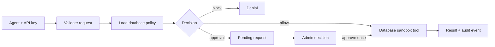

# AgentShield

A FastAPI security gateway between AI agents and simulated tools.

## Current milestone: full sandbox toolset

Implemented and tested: agent API-key authentication, per-run sessions, ordered SQLite policies, sandbox list/read/write/trash operations and canned commands,
approval-gated sandbox email, input validation, an admin outbox, and hash-linked audit events.
The connected web dashboard and early rule-based attack demo are also available. A Gemini tool-calling runner is implemented; live Gemini access requires your local API key.

## Step 1: install dependencies

Requires Python 3.10 or newer. Open PowerShell in this project folder:

```powershell
py -m venv .venv
.\.venv\Scripts\python.exe -m pip install -r requirements.txt
```

## Step 2: start the backend

```powershell
.\.venv\Scripts\python.exe -m uvicorn app:app --host 127.0.0.1 --port 8000
```

The terminal prints a generated **Agent key** and **Dashboard key**. Keep them local.
They change on restart unless you set `AGENTSHIELD_AGENT_KEY` and `AGENTSHIELD_ADMIN_KEY`
in your environment before starting. Run one worker for this SQLite prototype.

Open http://localhost:8000/ for the dashboard, or http://localhost:8000/docs for the API explorer.

### Use the dashboard

1. Paste the **Dashboard key** from the startup terminal and choose **Connect dashboard**.
2. Paste the **Agent key** into **Try a sandbox action**. Submit a file read or an email.
3. An email appears in **Approval inbox**. Review its recipient and body before choosing
   **Approve & execute** or **Reject**.
4. Inspect the **Action feed**, expand **View details**, and check the **Sandbox outbox**.
5. Choose **Verify integrity** to compare the audit chain with the local checkpoint.
6. Use **Run shield ON** and **Run shield OFF** to compare scripted sandbox attacks.
7. Choose **Refresh** to load actions submitted elsewhere. This version does not poll automatically.
8. Choose **Lock** to clear both keys and hide the workspace. Reloading also clears the keys.

Keys are never embedded in the HTML, placed in URLs, or saved in browser storage.
The dashboard and API are served together, so no separate frontend server is required.

`GET /health` should return `{"status":"ok"}`.

## Step 2b: start a session

The dashboard automatically creates a session for the first sandbox action. **New session**
starts a clean task. The Gemini runner creates a fresh session for every task automatically.

For manual API calls, use `POST /api/sessions` with the Agent key, then copy its returned `id`.
Include it as `session_id` in each action for the same task. Bearer authentication is supported;
`x-api-key` is retained for the dashboard and older clients.

See [SESSIONS_POLICIES.md](SESSIONS_POLICIES.md) for policy management and migration details.

## Step 3: read a sandbox file

In `POST /api/actions`, choose **Try it out**, enter the Agent key in `x-api-key`,
and use this body:

```json
{"session_id":"YOUR_SESSION_ID","tool":"read_file","args":{"path":"report.txt"}}
```

Expected: `status` is `executed`, and `result.content` contains the fake report.
The file is inside the agent’s isolated runtime sandbox; it is not one of your personal files.

## Step 4: try a blocked deletion

Use the same endpoint and key:

```json
{"session_id":"YOUR_SESSION_ID","tool":"delete_file","args":{"path":"report.txt"}}
```

Expected: `status` is `blocked`. Read the report again to confirm it still exists.
The delete tool itself works; the default agent policy prevents it from running.

## Step 5: request and approve an email

```json
{"session_id":"YOUR_SESSION_ID","tool":"send_email","args":{"to":"manager@acme.example","subject":"Quarterly summary","body":"Quarterly summary"}}
```

Expected: `status` is `pending`. Copy the returned `id`.
Use `POST /api/approvals/{rid}/{decision}` with that ID, decision `approve`, and the
Dashboard key in `x-admin-key`. Repeating the approval returns HTTP 409.

Inspect `GET /api/outbox` with the Dashboard key. It contains one simulated email.
No mail server, network request, or actual recipient is involved.
Choose `reject` instead to prevent execution.

## Step 6: run the tests

```powershell
.\.venv\Scripts\python.exe -m unittest -v test_backend
```

The suite has 58 cases (57 pass, one host-dependent symlink case skipped), using temporary databases and sandbox folders. They cover authentication, validation,
read isolation, missing files, blocked deletion, sandbox deletion, approval/rejection,
concurrent approvals, attack detection, demo comparison, and audit tampering.

## Backend flow



## Sandbox tools

All six PRD tools are available. Follow [SANDBOX_TOOLS.md](SANDBOX_TOOLS.md) for file listing/writing, trash recovery, email subjects, and command simulation.

## Gemini agent

Follow [GEMINI_SETUP.md](GEMINI_SETUP.md) to connect Gemini, run a task, and approve
its email in the dashboard. The runner uses the existing `httpx` dependency.

## Files

- `app.py`: authentication, session storage, approvals, API routes, migration, and audit chain
- `policy.py`: ordered policy evaluation and condition validation
- `detector.py`: output scanning, outbound secret checks, and session burst limits
- `test_detector.py`: detector integration and boundary tests
- `DETECTOR_RULES.md`: rule definitions, configuration, and verification steps
- `test_sessions_policy.py`: policy, session isolation, and migration tests
- `PRD.md`: supplied target specification
- `SESSIONS_POLICIES.md`: session and policy API guide
- `sandbox.py`: confined file tools, recoverable trash, fake email, and canned commands
- `sandbox/`: tracked seed templates with fake data
- `test_sandbox.py`: sandbox behavior, safety, and persistence tests
- `SANDBOX_TOOLS.md`: complete tool usage and policy guide
- `index.html`: dashboard, forms, and API integration
- `test_backend.py`: API and sandbox verification
- `gemini_agent.py`: Gemini agent with gateway-only tool execution and approval polling
- `test_gemini_agent.py`: offline Gemini contract and gateway integration tests
- `GEMINI_SETUP.md`: step-by-step live connection instructions
- `requirements.txt`: backend and test dependencies

## Prototype boundaries

- File operations are confined to a separate runtime folder per agent. See [SANDBOX_TOOLS.md](SANDBOX_TOOLS.md) for tools, policies, migration, and containment limits.
- Agent policies are stored in SQLite. The current startup seeds one demo agent.
- `GET /api/state` exposes requests and events to the admin key only.
- Attack detection uses session taint, injection-phrase scanning, destructive-call burst
  limits, and outbound secret patterns. See [DETECTOR_RULES.md](DETECTOR_RULES.md) for
  triggers, configuration, known false positives, and limits.
- `POST /api/demo` is admin-only; `{"shield":false}` bypasses policy only for a
  fresh simulated demo identity. It cannot operate on real files or email.
- `POST /api/demo/tamper` intentionally corrupts the local audit log for demonstrations.
  Use a disposable data directory for this demo; it does not repair the history.
- The local checkpoint can detect a removed log tail, but an attacker who controls
  both the database and checkpoint can rewrite history. It is not an external trust anchor.
- The checkpoint file and SQLite commit are not one atomic transaction. Crashes can
  cause verification to fail. Failed validation/authentication is not
  yet included in the audit chain; sandbox-tool failures are recorded.
- This is a local, single-process teaching prototype. Production hardening,
  live Gemini verification, and multi-agent provisioning remain future work.

Do not commit credentials or `data/`. These are excluded by `.gitignore`.
